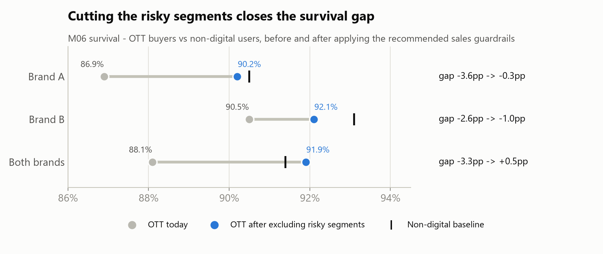
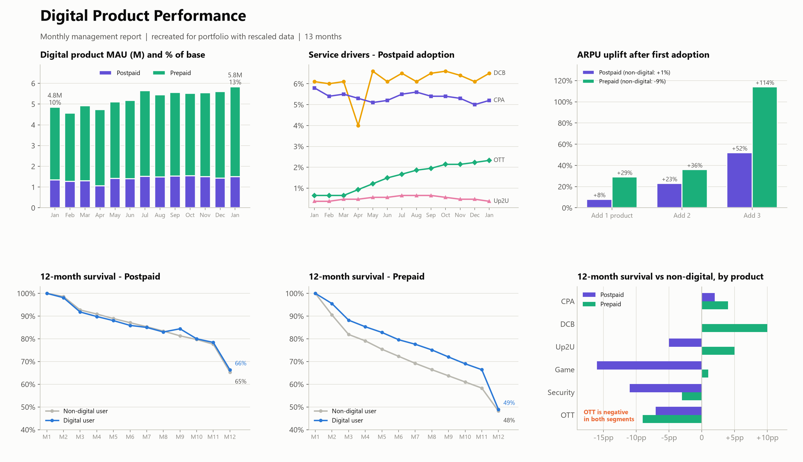
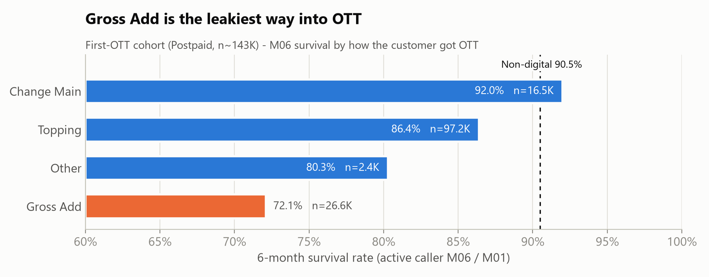
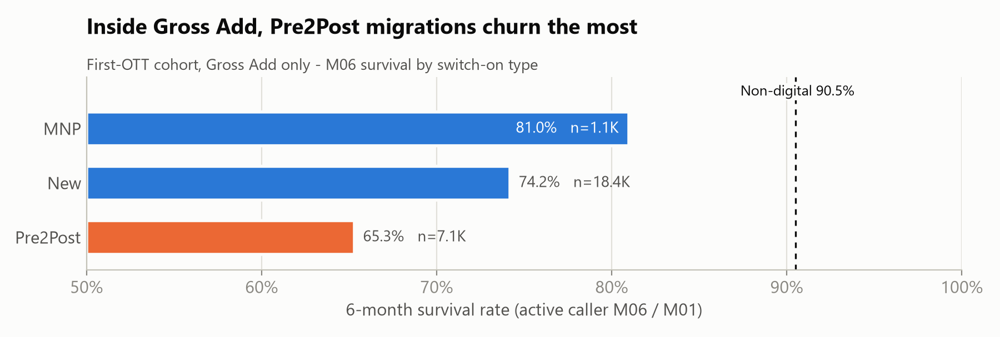
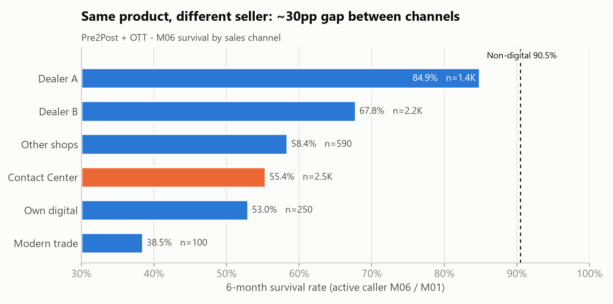
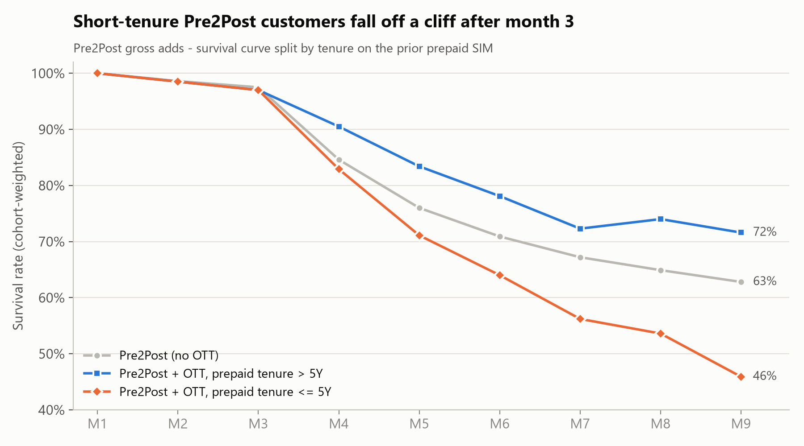
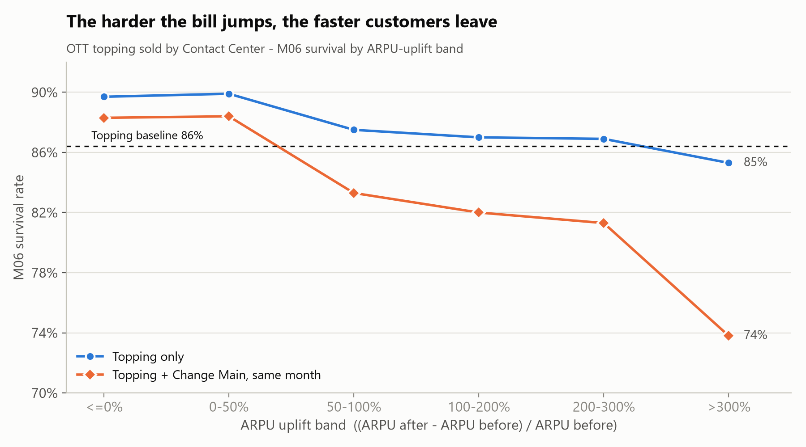
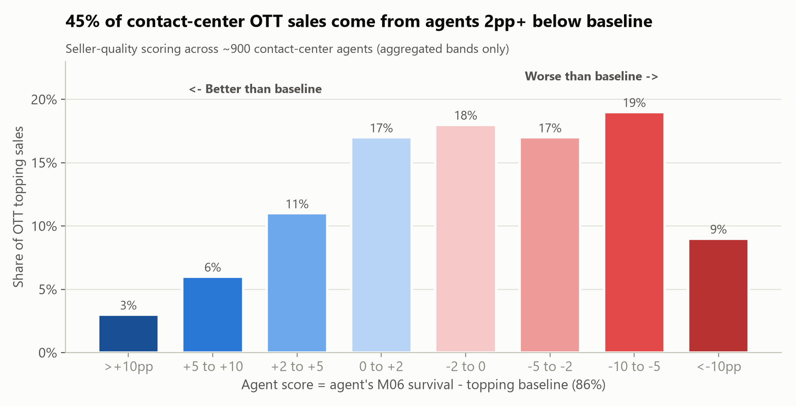
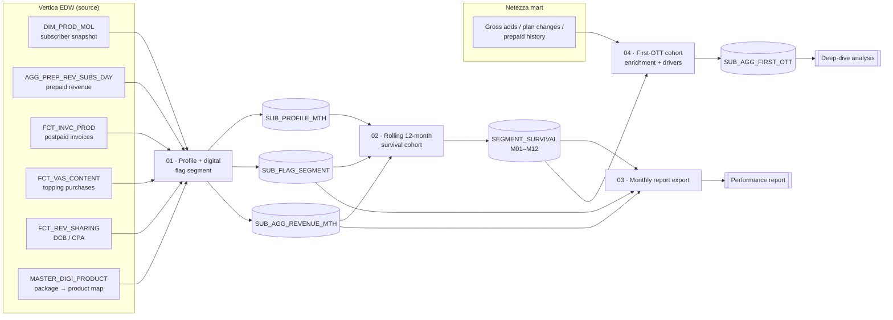

# Digital Product Analytics — Performance Tracking & OTT Retention Deep-Dive

**Telecom · Customer Value Management · Thai mobile operator (two brands) · 2025–2026**

> **About the numbers.** This is real work done on production data. To protect confidential information, all figures in this repository are **rescaled or indexed**: counts are scaled, rates are slightly perturbed, and money is shown as an index. Brand, dealer and product names are anonymised. **The patterns, rankings and conclusions are the same as in the original analysis.**

A two-part project on a national mobile base (Postpaid + Prepaid, ~5.8M digital-product users a month in this rescaled view).

1. **Performance report.** A monthly report that tracks MAU, digital adoption by product, ARPU uplift and 12-month survival. It compares customers who buy digital products (OTT, Game, Security, Up2U, carrier billing) with non-digital customers.
2. **Root-cause deep-dive.** The report showed that **OTT buyers churn faster than non-digital users**, even though most other digital products help retention. I traced the gap to specific acquisition paths, channels, sellers and price-shock patterns, then turned the findings into sales guardrails.

> ### Impact
> The recommended sales guardrails **close the OTT survival gap from −3.6pp to −0.3pp** for Brand A Postpaid, and from **−3.3pp to +0.5pp** across both brands, which means OTT buyers would retain as well as non-digital users.



---

## Part 1 — Digital Product Performance Report

The monthly report for management. It is built from three SQL pipelines on the data warehouse and presented as a one-page dashboard. The original is a PowerPoint slide; it is recreated here with rescaled data:



| Metric | Start | +12 months | Read-out |
|---|---|---|---|
| Digital product MAU | 4.8M | **5.8M** | +20% YoY, about three-quarters from Prepaid |
| % of base using a digital product | 10% | **13%** | Adoption rising steadily |
| Postpaid OTT adoption | 0.7% | **2.3%** | Fastest-growing service (×3.5) |
| Prepaid CPA adoption | 10% | **13%** | Largest prepaid driver |

**ARPU uplift after first adoption** (customers compared month-before vs month-after their first digital product; ARPU indexed to adopters' "before" = 100):

| Segment | Adopters | ARPU index before → after | Uplift | Non-digital (control) |
|---|---|---|---|---|
| Postpaid | ~325K | 100 → 110 | **+10%** | +1% |
| Prepaid | ~1.5M | 100 → 129 | **+29%** | −9% |

Adding more products adds more uplift. Postpaid: +8% with 1 product, +23% with 2, +52% with 3.

**12-month survival vs non-digital users.** Most digital products retain at least as well as non-digital users. **OTT is a consistent negative outlier**, and that triggered Part 2:

| Product | Postpaid | Prepaid |
|---|---|---|
| CPA | +2pp | +4pp |
| DCB (carrier billing) | 0pp | +10pp |
| Up2U | −5pp | +5pp |
| **OTT** | **−7pp** | **−9pp** |
| Security | −11pp | −3pp |
| Game | −16pp | +1pp |

➡️ Full write-up: [docs/01_performance_report.md](docs/01_performance_report.md)

---

## Part 2 — Why do OTT buyers churn more?

**Question:** Why is 6-month survival 86.9% for Postpaid OTT buyers but 90.5% for non-digital users?

**Approach:** I built a *first-OTT cohort*: ~143K Postpaid customers by the month they first bought OTT. Each customer was tagged with **how** they got OTT (new line, plan change, add-on topping), **who sold it** (channel, dealer, agent), **the bill shock** (ARPU before → after) and **tenure**. Then I broke survival down along each of these dimensions.

### Finding 1 — Gross Add is the leakiest entry point, and Pre2Post is the worst of it





### Finding 2 — The same product survives very differently depending on the seller

Pre2Post + OTT survival ranges from **84.9% at the best dealer to 55.4% via Contact Center**, a ~30pp spread for the same offer. The weak channels sell mostly one bundle ("Bundle X", 95% of Contact Center Pre2Post OTT sales).



### Finding 3 — Short-tenure prepaid migrants fall away after month 3

Migrants with more than 5 years on their prepaid SIM retain far better (72% at M9) than those with 5 years or less (46%). The second group does worse than Pre2Post customers who never bought OTT.



### Finding 4 — Bill shock drives churn, especially when a plan change is bundled in

ARPU uplift = (ARPU after − ARPU before) / ARPU before. Survival falls as uplift rises. Selling a topping **and** changing the main plan in the same call amplifies the effect, down to 74% at >300% uplift.



### Finding 5 — Seller quality is measurable, and it is concentrated

I scored ~900 contact-center agents by the M06 survival of the customers they sold to, relative to the topping baseline. **45% of OTT topping sales come from agents 2pp or more below baseline.** Agents in the −5 to −10pp band push "topping + plan change" bundles in **52%** of their sales. Agents in the +2 to +5pp band do so in only **10%**.



### Supporting evidence
- **Churn is not preceded by engagement.** Of customers who bought OTT via Contact Center and churned by M06, **81% never bought another topping** before leaving.
- **Voice of customer.** In public forum posts about the streaming bundle, the recurring themes were: being billed without knowingly subscribing, failed plan-tier upgrades, a hard-to-reach call center, and ~10-day resolution times.

### Recommendations (sales guardrails)

ARPU thresholds are expressed relative to the average postpaid ARPU (= 1.0×).

| Context | Avoid | Target instead |
|---|---|---|
| Pre2Post gross add + OTT | Prepaid tenure ≤ 5 years; Contact Center channel | Tenure > 5 years, dealer channel |
| Topping only | ARPU uplift > 300% | ARPU before ≥ 1.0× average |
| Topping + plan change, same month | ARPU uplift > 50% | ARPU before ≥ 2.5× average |
| Contact Center agents | Bottom performance bands | Coach on bundle-pushing; monitor agent survival score monthly |

**Trade-off made explicit:** applying all guardrails keeps ~68% of monthly OTT volume and lifts M06 survival from 86.9% to **90.2%**.

➡️ Full write-up: [docs/02_ott_churn_deep_dive.md](docs/02_ott_churn_deep_dive.md)

---

## Data Engineering

Everything above is produced by SQL pipelines on a **Vertica** EDW, with supporting extracts from a **Netezza** data mart.



| Script | What it does |
|---|---|
| [`sql/01_profile_flag_segment.sql`](sql/01_profile_flag_segment.sql) | Pre-validation checks on every source table. Builds the monthly subscriber profile (excluding silent/test lines; tourist/migrant/mass SIM typing). Harmonizes prepaid (VAT-excluded usage) and postpaid (invoice) revenue. Flags 6 digital products from both main packages and toppings. Adds tenure bands. |
| [`sql/02_survival_cohort.sql`](sql/02_survival_cohort.sql) | Incremental monthly load of a rolling 12-month cohort matrix: inserts the new cohort, then back-fills M02–M12 for the previous 11 cohorts (active, active-caller, digital, revenue). |
| [`sql/03_monthly_report_export.sql`](sql/03_monthly_report_export.sql) | Report layer: MAU and product mix, service drivers, ARPU-uplift movement (product count month-over-month), and cohort-weighted survival curves that use only cohorts with complete follow-up at each horizon. |
| [`sql/04_first_ott_churn_deep_dive.sql`](sql/04_first_ott_churn_deep_dive.sql) | Builds the first-OTT cohort and loads Netezza extracts back into Vertica. Attributes channel/dealer/agent with an effective-dated partner dimension join. Computes ARPU before/after with fallback rules for missing months. Adds uplift-type and retention flags, scores sellers, and runs ~40 driver cuts. |

**Techniques used:** MPP table design (`SEGMENTED BY HASH`, `DISTRIBUTE ON`), session temp tables, window functions (`ROW_NUMBER` de-duplication, first-event detection), SCD-style effective-date joins, incremental cohort back-fill, cross-platform extract/load (Netezza external tables), data-quality pre-checks, survival/retention metrics with censoring-aware denominators.

### What I would do differently next time
- **Long-format cohort table.** Store `(cohort_month, subscriber, month_offset, …)` instead of 60 wide columns plus 11 `UPDATE` statements. It is simpler to load and easier to extend beyond 12 months.
- **Parameterize run dates** instead of editing hard-coded snapshot dates.
- **Consolidate repeated `UNION ALL` report blocks** into a single join with unpivoted product flags.

---

## Repository structure

```
├── README.md
├── docs/
│   ├── 01_performance_report.md
│   ├── 02_ott_churn_deep_dive.md
│   ├── make_charts.py          # renders all charts (rescaled figures)
│   └── images/
└── sql/
    ├── 01_profile_flag_segment.sql
    ├── 02_survival_cohort.sql
    ├── 03_monthly_report_export.sql
    └── 04_first_ott_churn_deep_dive.sql
```

**Tools:** SQL (Vertica, Netezza) · Excel · PowerPoint

> *The SQL logic is shared as written in production. Schema, brand, product and dealer names are anonymised, and personal identifiers are removed. No customer-level data is included.*
