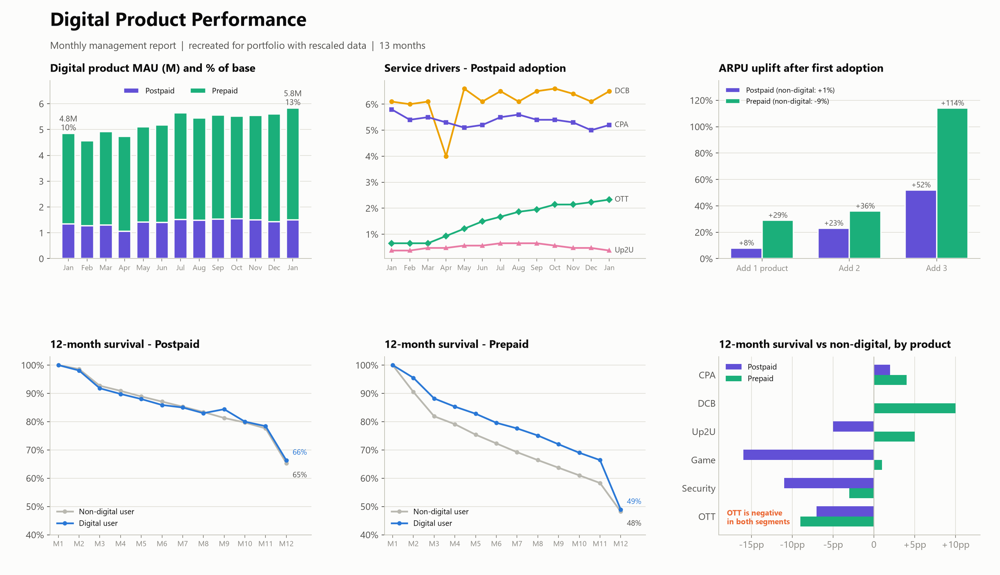

# Part 1 — Digital Product Performance Report

[← Back to README](../README.md)

> All figures are rescaled or indexed (see the note in the README). Patterns and conclusions match the original analysis.

## Business context

The operator sells several "digital lifestyle" products alongside mobile plans:

| Product group | What it is | How it is detected in data |
|---|---|---|
| **OTT** | Video streaming bundles (global and regional streaming services, sports) | Main package or topping mapped to `Digital - OTT` |
| **Game** | Game top-ups and passes | Main package or topping mapped to `Digital - Game` |
| **Up2U** | Lifestyle add-ons | Main package or topping mapped to `Digital - Up2U` |
| **Security** | Mobile security / protection | Main package or topping mapped to `Digital - Secure` |
| **DCB** | Direct carrier billing (pay for app-store content on the phone bill) | Revenue-sharing fact, `REV_TYPE = 'DCB'` |
| **CPA** | Content-provider subscriptions billed to the line | Revenue-sharing fact, `REV_TYPE = 'CPA'` |

Management asked three questions:
1. How many customers use digital products, and is adoption growing?
2. Does buying a digital product make a customer more valuable (ARPU)?
3. Does it make them more loyal (survival)?

## Report

*One-page monthly report, recreated with rescaled data.*

### 1. MAU situation
- Digital product MAU grew from **4.8M to 5.8M over 12 months, +20% YoY**.
- The share of active users with at least one digital product rose from **10% to 13%**.
- Prepaid makes up ~74% of digital MAU.

### 2. Service drivers (adoption by product, % of active base)
- **Postpaid:** DCB (~6%) and CPA (~5%) are stable. **OTT is the growth story: 0.7% → 2.3% in 12 months.**
- **Prepaid:** CPA dominates (10% → 13%). DCB is ~1.4%. Security launched mid-year and reached ~0.5%.

### 3. ARPU uplift after first adoption
For customers whose number of digital products increased month-over-month, I compared revenue in the month before with the month after. ARPU is indexed so that all adopters' "before" = 100.

| Postpaid | #Subs | ARPU index before | ARPU index after | Uplift |
|---|---|---|---|---|
| No digital product (control) | ~10.4M | 64 | 65 | +1% |
| Add 1 product | ~278K | 99 | 107 | +8% |
| Add 2 products | ~47K | 106 | 130 | +23% |
| Add 3 products | ~460 | 112 | 170 | +52% |
| **All adopters** | **~325K** | **100** | **110** | **+10%** |

| Prepaid | #Subs | ARPU index before | ARPU index after | Uplift |
|---|---|---|---|---|
| No digital product (control) | ~20.8M | 47 | 43 | −9% |
| Add 1 product | ~1.42M | 100 | 129 | +29% |
| Add 2 products | ~96K | 98 | 133 | +36% |
| Add 3 products | ~1.1K | 107 | 229 | +114% |
| **All adopters** | **~1.51M** | **100** | **129** | **+29%** |

**Read-out:** digital adoption is clearly accretive, and each additional product adds more uplift. Adopters also start from a much higher ARPU than non-digital customers.

### 4. Survival rate (active-caller retention, M1 → M12)
Survival = share of a monthly cohort that is still an *active caller* k months later. The figures are averaged across cohorts, and each horizon uses only cohorts that have reached it. Without that rule, recent cohorts would inflate the late months.

- **Overall:** Digital users retain about the same as non-digital users at 12 months (about +1pp in both Postpaid and Prepaid).
- **By product:** this is where the averages hide the story.

| Product | Postpaid vs non-digital | Prepaid vs non-digital |
|---|---|---|
| CPA | +2pp | +4pp |
| DCB | 0pp | +10pp |
| Up2U | −5pp | +5pp |
| **OTT** | **−7pp** | **−9pp** |
| Security | −11pp | −3pp |
| Game | −16pp | +1pp |

OTT is the only product that is clearly below non-digital users in **both** segments. It is also the fastest-growing product, so the business risk compounds. Game and Security in Postpaid have very small bases (<0.2% adoption), so they were not prioritised.

## Decision
OTT growth was bringing in customers who left sooner than average. Management asked for a root-cause analysis, which became **[Part 2 — OTT churn deep-dive](02_ott_churn_deep_dive.md)**.

## How it is built

| Step | SQL | Output |
|---|---|---|
| Validate source freshness and row counts | [`01_profile_flag_segment.sql`](../sql/01_profile_flag_segment.sql) §0.2 | QA queries |
| Monthly subscriber profile | §1 | `AUTO_SUB_PROFILE_MTH` |
| Revenue (prepaid usage ex-VAT + postpaid invoice) | §2 | `AUTO_LIFESTYLE_SUB_AGG_REVENUE_MTH` |
| Digital flags from main packages, toppings, DCB/CPA | §3–6 | `AUTO_LIFESTYLE_SUB_FLAG_SEGMENT` |
| Rolling 12-month survival matrix | [`02_survival_cohort.sql`](../sql/02_survival_cohort.sql) | `AUTO_LIFESTYLE_SUB_SEGMENT_SURVIVAL_ACTIVE_CALLER` |
| Report extracts (MAU, drivers, ARPU uplift, survival) | [`03_monthly_report_export.sql`](../sql/03_monthly_report_export.sql) | Excel → PowerPoint |
