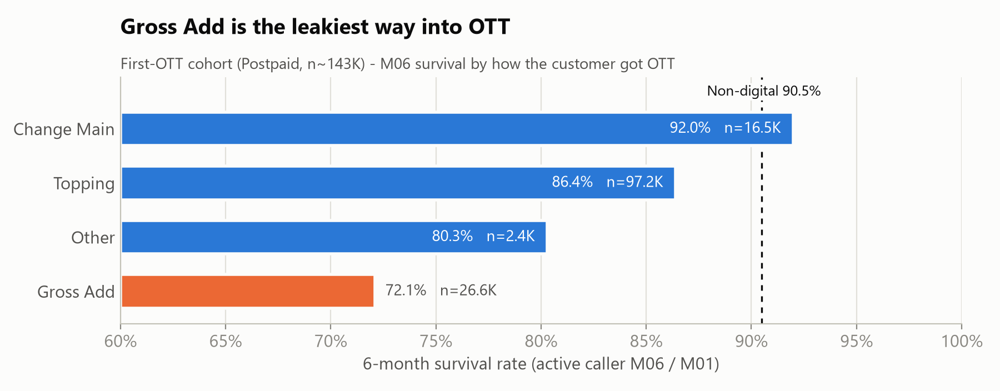
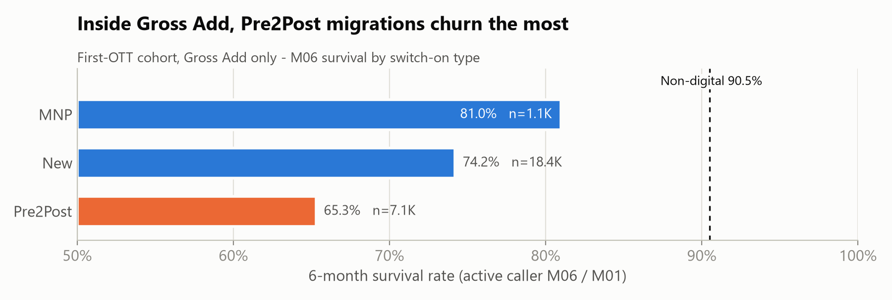
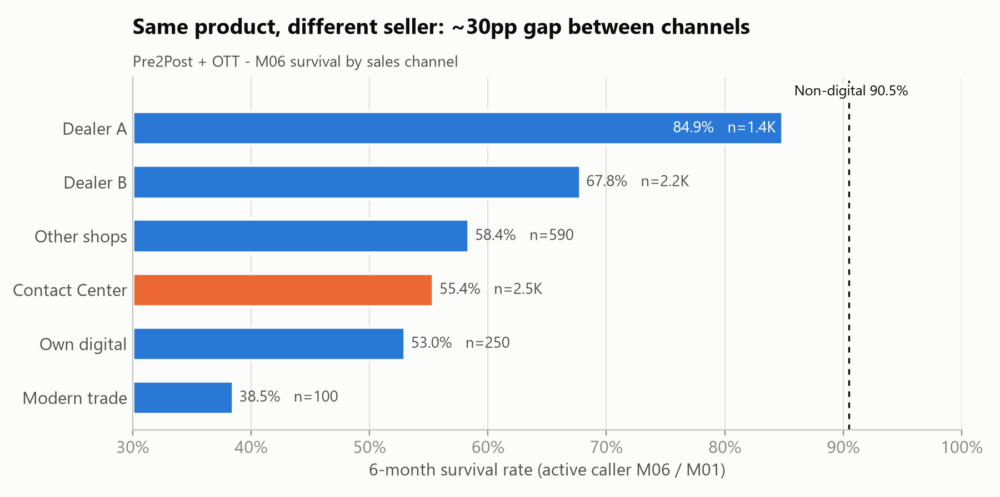
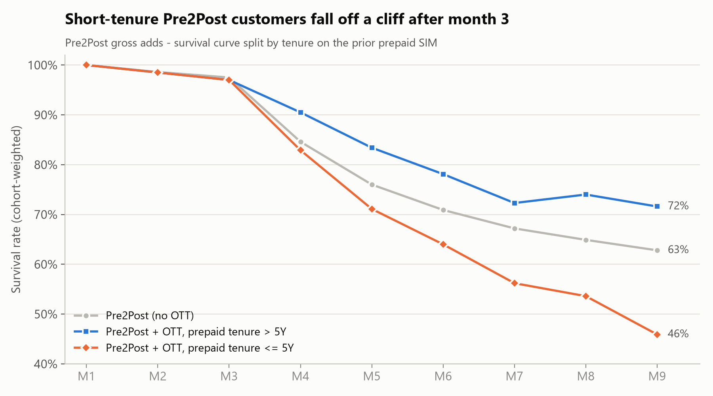
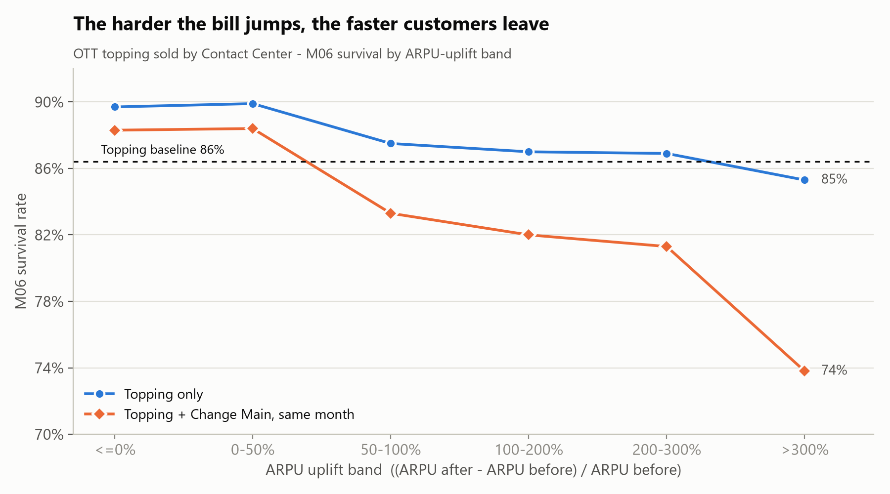
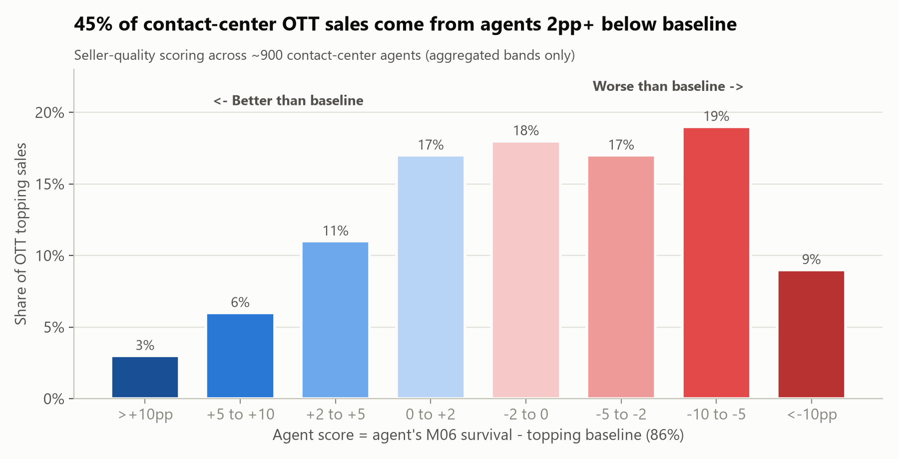
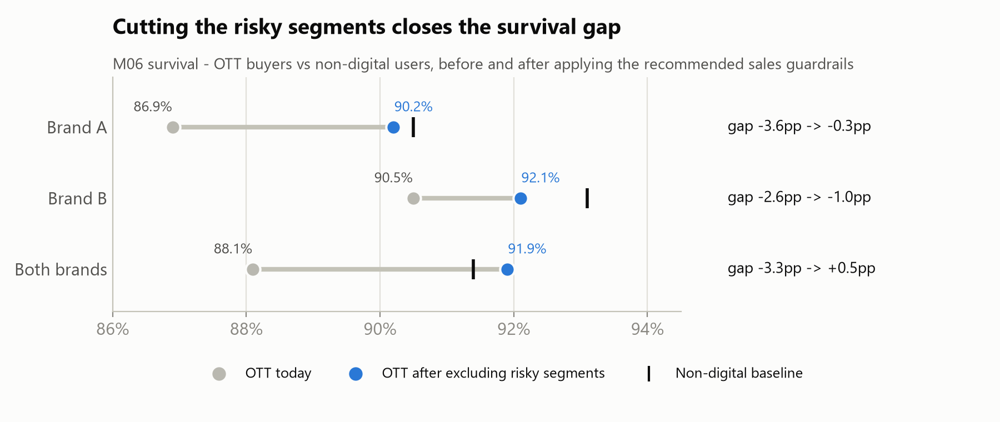

# Part 2 — Why Do OTT Buyers Churn More?

[← Back to README](../README.md)

> All figures are rescaled or indexed (see the note in the README). Patterns and conclusions match the original analysis.

## Problem

| Segment (Brand A Postpaid) | Avg subs / month | M06 survival |
|---|---|---|
| Non-digital users | ~7.5M | 90.5% |
| OTT buyers | ~61K | **86.9% (−3.6pp)** |

OTT was the fastest-growing digital product, but its buyers churned faster than customers with no digital product at all (see [Part 1](01_performance_report.md)).

## Method

1. **Define a clean cohort.** Take each Postpaid subscriber's **first** month holding OTT (`ROW_NUMBER() OVER (PARTITION BY subscriber ORDER BY month)`), restricted to a five-month window so that every customer has a full 6-month follow-up. This gives **~143K customers**, with a baseline M06 survival of **84.3%**.
2. **Attribute the acquisition path:**
   - **Gross Add.** A new line, MNP port-in or Prepaid→Postpaid migration, where the first plan already contains OTT. Data comes from the Netezza sales mart.
   - **Change Main.** An existing customer moves to an OTT-bundled plan (after-sale or retention).
   - **Topping.** An OTT add-on is bought on top of the existing plan.
3. **Attribute the seller.** Channel, dealer and agent come from the topping transaction. The partner dimension is joined by effective date (`REQ_DT BETWEEN BEG_EFF_DATE AND END_EFF_DATE`), with fallbacks through the employee and shop-staff dimensions.
4. **Quantify bill shock.** ARPU before = invoice in M-1. ARPU after = invoice in M+1. Fallback rules handle missing months and pro-rated first bills.
5. **Cut survival by each dimension**, compare it to the cohort baseline and the non-digital baseline, and check sample sizes before calling a driver.
6. **Validate across brands.** The same analysis was repeated on the sister brand (Brand B) to confirm the patterns were not brand-specific.

## Findings

### 1. Acquisition path — Gross Add drags the cohort down

| Path | Subs | Mix | M06 survival | vs cohort |
|---|---|---|---|---|
| Change Main | ~16.5K | 12% | 92.0% | +7.7pp |
| Topping | ~97.2K | 68% | 86.4% | +2.1pp |
| Other | ~2.4K | 2% | 80.3% | −4.0pp |
| **Gross Add** | **~26.6K** | **19%** | **72.1%** | **−12.2pp** |

Within Gross Add: MNP 81.0%, New 74.2%, **Pre2Post 65.3%**.

### 2. Channel — the same product, very different outcomes

Pre2Post + OTT by sales channel: **Dealer A 84.9%** vs **Contact Center 55.4%**. In the Contact Center, 95% of these sales were a single bundle ("Bundle X", 55% survival). At Dealer A, the mix was led by a sports bundle (86%).

**Package price matters too.** Gross-add plans in the two highest price tiers survived at 64% and 55%. Mid-tier plans survived at 77–79%.

### 3. Tenure — prior prepaid tenure predicts postpaid loyalty

- Across all channels, Pre2Post + OTT survival rises with tenure on the prior prepaid SIM, from **43% (0–1 month) to 76% (>5 years)**.
- On the full survival curve, migrants with more than 5 years of tenure hold **72% at M9**. Those with 5 years or less drop to **46%**, below Pre2Post customers without OTT (63%).
- The same pattern holds for topping buyers. Survival climbs from **68% (<3 months on network) to 93% (>5 years)**.

### 4. Bill shock — uplift band × type of sale (Contact Center toppings)

ARPU before is shown as a multiple of the average postpaid ARPU.

| Uplift band | Topping only: ARPU before | Topping only: M06 | Topping + plan change: ARPU before | Topping + plan change: M06 |
|---|---|---|---|---|
| ≤ 0% | 3.2× | 89.7% | 3.9× | 88.3% |
| 0–50% | 2.7× | 89.9% | 2.6× | 88.4% |
| 50–100% | 2.5× | 87.5% | 2.2× | 83.3% |
| 100–200% | 1.5× | 87.0% | 1.6× | 82.0% |
| 200–300% | 1.0× | 86.9% | 1.2× | 81.3% |
| **> 300%** | **0.5×** | **85.3%** | **0.7×** | **73.8%** |

High uplift is mostly a **low-ARPU-before** problem: an annual streaming topping sold to a customer on an entry-level plan is a >300% bill increase. Bundling a plan change into the same call makes the shock worse.

Inside the "topping + plan change" group, when both happened **in the same call with the same agent**, survival was 77.4%. When the plan change came through another channel, survival was 88.9%.

### 5. Seller quality — a measurable, concentrated problem

**Agent score** = M06 survival of the agent's customers − the topping baseline (86%). I computed it for ~900 Contact Center agents and grouped the scores into bands. Only aggregated bands are shown.

| Score band | Share of sales |
|---|---|
| > +10pp | 3% (mostly very low-volume agents) |
| +5 to +10 | 6% |
| +2 to +5 | 11% |
| 0 to +2 | 17% |
| −2 to 0 | 18% |
| −2 to −5 | 17% |
| −5 to −10 | 19% |
| < −10pp | 9% |

Comparing two bands with similar volume:

| | +2 to +5pp agents | −5 to −10pp agents |
|---|---|---|
| Sales that are topping only | 90% | 48% |
| Sales that bundle topping + plan change | **10%** | **52%** |
| M06 survival at > 300% uplift (bundled sales) | 72% | 74% |

The weaker agents are not worse at the same sale. **They make a riskier kind of sale far more often.** That makes the problem fixable through sales rules, not only through coaching.

### 6. Supporting evidence
- **81%** of customers who churned within 6 months of a Contact Center OTT topping **never bought another topping** before leaving (87% for Brand B).
- **Voice of customer.** I analysed public forum threads about the streaming bundle with a word cloud. Four themes came up: (1) billed for the service without knowingly subscribing, (2) technical failures upgrading the plan tier, (3) hard to reach the call center, (4) ~10 days to resolve.

## Recommendations

| # | Sales guardrail | Evidence |
|---|---|---|
| 1 | Offer OTT on **Pre2Post** only to customers with **> 5 years** prepaid tenure | 72% vs 46% at M9 |
| 2 | Review **Contact Center Pre2Post OTT** sales of Bundle X | 55% M06 survival; customer complaints |
| 3 | **Topping only:** block offers at **> 300% uplift**; prioritise ARPU before ≥ 1.0× average | Survival declines with uplift; 85% at > 300% |
| 4 | **Topping + plan change:** block at **> 50% uplift**; prioritise ARPU before ≥ 2.5× average | 74% at > 300% uplift |
| 5 | Track the **agent survival score** monthly and coach the bottom bands on bundling behaviour | 52% vs 10% bundling rate |

## Impact (simulated on the analysis cohort)

| | OTT M06 survival: today | After guardrails | Non-digital | Gap: today → after |
|---|---|---|---|---|
| Brand A | 86.9% | 90.2% | 90.5% | −3.6pp → **−0.3pp** |
| Brand B | 90.5% | 92.1% | 93.1% | −2.6pp → **−1.0pp** |
| Both brands | 88.1% | 91.9% | 91.4% | −3.3pp → **+0.5pp** |

**Trade-off:** the guardrails keep ~68% of Brand A OTT monthly volume. The excluded volume is the segment that churns fastest, so most of the lost sales would have been lost customers within six months anyway.

## Limitations
- Survival is measured as *active caller*, not contractual disconnection, so it also captures inactivity.
- The impact figure is a re-cut of historical data, not an A/B test. The next step would be to pilot the guardrails in one channel.
- Agent scores for agents with very few sales are noisy. The > +10pp band averages under 5 sales per agent, so those agents should be excluded from performance management.
